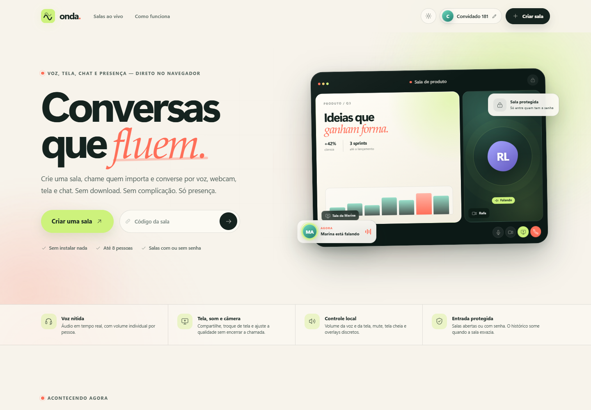
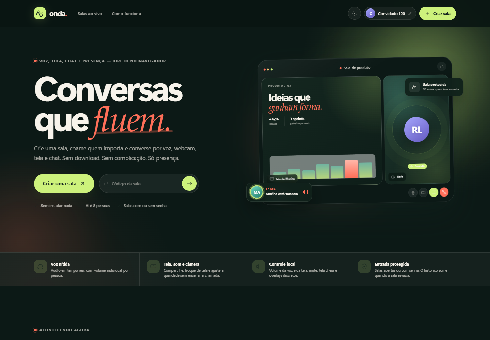
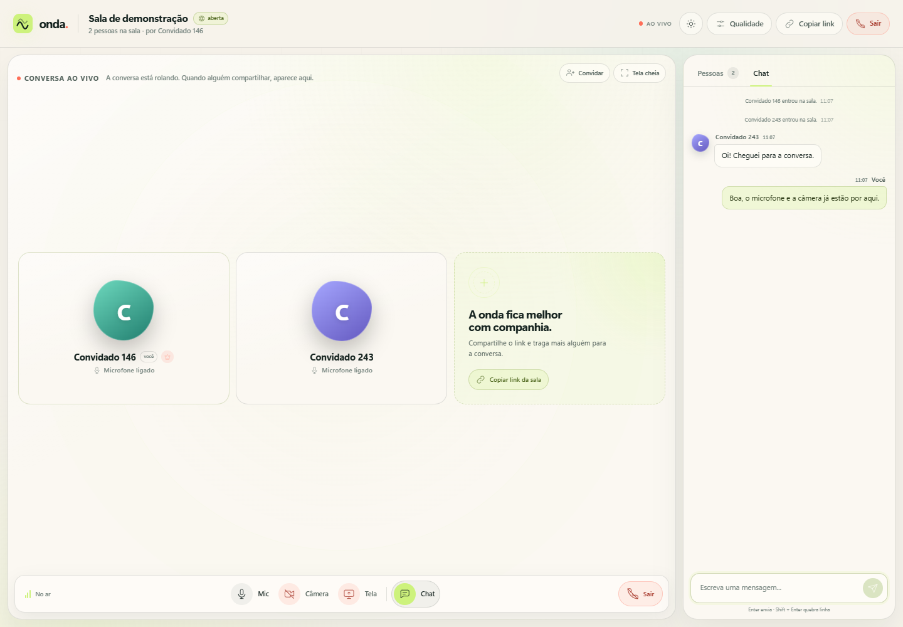
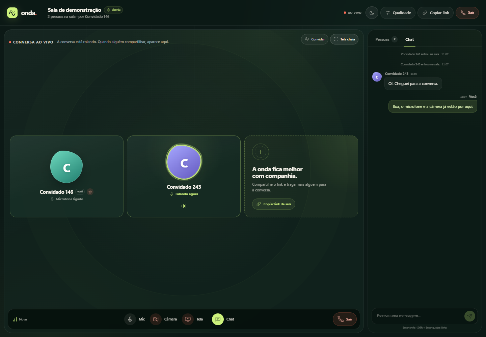
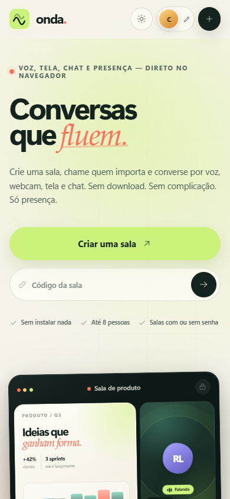

# Onda

Uma sala de conversa completa no navegador: **voz, webcam, compartilhamento de tela e chat**, construída com **Blazor Server**, com dois modos de mídia:

- **Mesh/P2P** para desenvolvimento e salas pequenas (até 8 pessoas).
- **LiveKit SFU** para o pacote de produção, com capacidade configurável (25 pessoas por padrão), qualidade de tela ajustável e TURN empacotado no Docker Compose.

O usuário recebe um nome aleatório ao entrar (por exemplo, `Convidado 482`), pode trocá-lo, criar salas abertas ou protegidas por senha e entrar por uma listagem ou link. Enquanto uma sala tem usuários, metadados e chat ficam em **SQLite**; ao sair a última pessoa, a sala e todo o histórico são apagados.

## Demonstração

**[Abrir o Onda — https://onda.dpbr.net](https://onda.dpbr.net)**

| Home clara | Home escura |
| --- | --- |
|  |  |

| Sala com duas pessoas | Sala no tema escuro |
| --- | --- |
|  |  |

<p align="center">
  
  <br />
  <sub>Home responsiva em 390 px.</sub>
</p>

> **App desktop para Windows:** [Onda Desktop](https://github.com/raiancollyn/ondaDesktop) — instalador NSIS, captura WGC, áudio por aplicativo e auto-update. As releases ainda não são assinadas.

## Rodando localmente

Pré-requisitos: **.NET SDK 10** (o projeto fixa `net10.0` e o SDK em `global.json`).

```powershell
cd Onda
dotnet run
```

Abra **http://localhost:5062**. Para testar o modo SFU localmente, veja [`deploy/README.md`](deploy/README.md#sem-docker--desenvolvimento-local); basicamente:

```powershell
# terminal 1: LiveKit de desenvolvimento
docker run --rm -p 7880:7880 -p 7881:7881 -p 7882:7882/udp `
  livekit/livekit-server:v1.13.11 --dev --bind 0.0.0.0

# terminal 2
cd Onda
dotnet run --launch-profile sfu
```

> Microfone, câmera e compartilhamento de tela exigem **HTTPS ou localhost**. Em outro dispositivo da rede, use HTTPS (o perfil `https` do projeto, um proxy reverso ou o Caddy do pacote Docker).

## O que está pronto

- **Identidade de convidado**: nome aleatório por sessão e edição de nome na página inicial e dentro da sala.
- **Salas ao vivo**: listagem apenas de salas com pessoas conectadas, busca e atualização em tempo real.
- **Criação de sala**: nome + privacidade aberta ou com senha; o criador entra automaticamente sem redigitar a própria senha.
- **Link compartilhável** (`/sala/codigo`): salas com senha exibem a tela de entrada protegida antes do acesso.
- **Chamadas**:
  - mesh WebRTC no modo padrão;
  - **LiveKit SFU** quando configurado, com tokens assinados no servidor e capacidade maior.
- **Microfone**: ativação com permissão, mute/retomada e detecção local de fala.
- **Indicador de fala** sincronizado nos avatares e na lista de pessoas.
- **Webcam e tela**: um compartilhamento de vídeo por pessoa, com destaque no palco e clique para ampliar/voltar à grade.
- **Câmera no celular**: quando o aparelho expõe mais de uma câmera, a sala permite escolher entre frontal e traseira; a lanterna aparece quando o navegador e a câmera suportam `torch`.
- **Aplicativos**: a home oferece o instalador do **Onda Desktop** em `/download/desktop` (resolvido para a última release do GitHub) e a instalação como **web app/PWA** pelo navegador, com manifest, service worker, ícone próprio e cache offline.
- **Controles durante a transmissão**: com a tela compartilhada, dá para **trocar a tela** e **silenciar/reativar o áudio da tela** sem encerrar a chamada; o botão **Parar** continua sendo o encerramento explícito.
- **Tela cheia**: a sala inteira ou uma tela/webcam individual pode ocupar o monitor; os overlays de mídia somem após 3 s sem movimento do mouse ou quando ele sai de cima da imagem, e voltam ao passar o mouse ou tocar.
- **Áudio da tela**: quando o navegador fornece a faixa, é publicada separadamente. O Firefox não captura áudio de tela; o app avisa no modal de qualidade e ao iniciar o compartilhamento.
- **Volume individual**: sliders por participante para voz e áudio de tela, com mute; ao assistir à tela de outra pessoa, o volume e o mute do áudio da tela também ficam disponíveis no próprio palco.
- **Qualidade do compartilhamento de tela**:
  - presets **Fluida**, **Equilibrada**, **Nítida** e **Personalizada**;
  - resolução (720p, 1080p, 1440p);
  - taxa de quadros (15, 24, 30, 60 fps);
  - bitrate (1 a 20 Mbps);
  - codec preferido (Automático, VP8, VP9, H.264 ou AV1);
  - prioridade para texto/nitidez ou movimento/fluidez.
- **Chat em tempo real**: histórico persistido em SQLite, mensagens de sistema, badge de não lidas, Enter para enviar e Shift+Enter para quebrar linha.
- **Ciclo de vida da sala**: ao clicar em **Sair**, a última pessoa apaga a sala, a senha e todo o histórico. Se a aba for fechada ou recarregada, há uma janela curta de 30 s para reentrar; depois o janitor apaga tudo.
- **Presença confiável**: heartbeat no servidor e saída imediata via beacon ao fechar a aba.
- **Interface responsiva**: landing page, gate de senha, sala em duas colunas e painel deslizante no celular.
- **Tema claro e escuro**: na primeira visita o site segue `prefers-color-scheme`; o controle de tema no cabeçalho da home, da sala e do gate oferece **Claro**, **Escuro** e **Sistema**. A escolha manual fica em `localStorage`; escolher **Sistema** remove a preferência e volta a acompanhar o tema do sistema. O tema é aplicado antes do CSS carregar (sem flash) e vale para todas as páginas e componentes. Mudanças do sistema são seguidas ao vivo enquanto a preferência for **Sistema**.
- **Deploy**:
  - [`Dockerfile`](Dockerfile) e [`deploy/docker-compose.yml`](deploy/docker-compose.yml) com app + LiveKit + Coturn;
  - overlay de TLS com Caddy;
  - **egg do app** no Pterodactyl (compila no primeiro boot);
  - **egg do LiveKit** separado no Pterodactyl;
  - opção de LiveKit standalone em container ([`deploy/livekit/`](deploy/livekit/)).

## Qualidade da transmissão

Abra o botão **Qualidade** no cabeçalho da sala. As preferências ficam no navegador (`localStorage`) e são aplicadas ao compartilhamento de tela.

| Preset | Captura | Bitrate | Indicado para |
|---|---:|---:|---|
| Fluida | 720p · 60 fps | 4 Mbps | Vídeo, animações e movimento |
| Equilibrada | 1080p · 30 fps | 5 Mbps | Uso geral |
| Nítida | 1440p · 30 fps | 9 Mbps | Texto, código e detalhes |
| Personalizada | escolha livre | 1–20 Mbps | Ajuste fino |

Também é possível escolher codec e prioridade de conteúdo. Observações:

- No modo **SFU**, ao salvar com uma tela ativa, resolução/FPS/bitrate/prioridade são aplicados na hora no capture e no sender, sem republicar a faixa e sem interromper quem está assistindo. O codec é definido na publicação e passa a valer no próximo compartilhamento.
- No SFU, quem assiste pede a camada de maior resolução para compartilhamentos de tela, priorizando texto legível; isso pode aumentar o consumo de banda.
- No modo **mesh**, a resolução, o FPS e o bitrate também podem ser reaplicados a um compartilhamento ativo; a preferência de codec é negociada em novas conexões (entrar novamente na sala).
- A disponibilidade de codecs depende do navegador e do servidor; se o preferido não for compatível, pode haver fallback.
- **Trocar tela** captura a nova fonte antes de substituir a antiga; se o usuário cancelar o seletor, a transmissão atual continua. O áudio da tela mantém o estado de mudo ao trocar.
- **Firefox** não implementa áudio em `getDisplayMedia`; nesse navegador o vídeo é compartilhado sem som e o app mostra um aviso. Use Chrome/Edge quando o conteúdo tiver áudio.
- 60 fps + 1440p + bitrate alto consomem mais CPU, banda e bateria. Se a qualidade cair, prefira Fluida ou Equilibrada.
- Em telas com muito texto, 30 fps e prioridade “Texto e nitidez” costumam dar um resultado mais legível do que 60 fps com bitrate baixo.

## Arquitetura

```
Blazor Server (UI, circuitos, salas, senhas, chat, presença)
        │
        ├── RoomService: presença em memória
        │     ├── heartbeat / presença
        │     └── ChatStore (SQLite): metadados e mensagens
        │
        ├── modo Mesh ─── webrtc.js (conexão direta por participante)
        │
        └── modo SFU ─── livekit-room.js ─── LiveKit Server
                                 ├── áudio, câmera e tela
                                 └── TURN (Coturn ou embutido no LiveKit)
```

- No mesh, cada pessoa cria uma `RTCPeerConnection` com cada outra pessoa e usa três transceptores fixos (microfone, vídeo, áudio da tela).
- No SFU, o app emite um **JWT LiveKit** assinado no servidor e passa apenas o token ao navegador. O token inclui a sala e a identidade do convidado.
- O servidor escolhe o modo por `Media__Provider` (`Mesh` ou `LiveKit`). Se a configuração do LiveKit estiver incompleta, o app usa mesh. Se a conexão com o SFU falhar, o app avisa; o chat e a lista de pessoas continuam funcionando.
- A presença é mantida em memória para respostas em tempo real. Metadados de sala e mensagens vão para SQLite. Ao sair a última pessoa explicitamente, as linhas são apagadas na hora; fechar/recarregar a aba deixa uma janela de 30 s para reentrar, e o janitor apaga o restante. O banco é limpo no boot do processo.
- A capacidade efetiva do mesh é limitada a **8 pessoas**; no SFU é o valor de `MAX_PARTICIPANTS` (limitado a 100).

### Principais arquivos

| Arquivo | Responsabilidade |
|---|---|
| `Services/RoomService.cs` | Salas, senhas, presença, chat e sinalização mesh |
| `Services/ChatStore.cs` | Persistência SQLite de salas e mensagens; limpeza ao esvaziar |
| `Models/StorageOptions.cs` | Caminho configurável do banco |
| `Services/LiveKitTokenService.cs` | JWT de entrada no LiveKit, assinado com HMAC-SHA256 |
| `Models/MediaOptions.cs` | Provider, capacidade, ICE/TURN e preferências de qualidade |
| `Components/Pages/Home.razor` | Landing page, criação e listagem de salas |
| `Components/Pages/Room.razor` | Gate, palco, chat, volume, qualidade e controles |
| `wwwroot/js/webrtc.js` | Mesh P2P, sinalização e ajustes de encoding |
| `wwwroot/js/livekit-room.js` | Integração com LiveKit SFU |
| `wwwroot/app.css` | Design system e responsividade |
| `deploy/` | Compose, Caddy, Coturn, Caddyfile e eggs Pterodactyl |
| `deploy/livekit/` | LiveKit standalone em container |

## Deploy com Docker

Consulte o guia completo em **[`deploy/README.md`](deploy/README.md)**.

Resumo:

```bash
cd Onda/deploy
cp .env.example .env
# edite domínios, chaves do LiveKit e credenciais do TURN
docker compose -f docker-compose.yml -f docker-compose.tls.yml up -d --build
```

Serviços incluídos:

- **Onda** (Blazor Server);
- **LiveKit** (`livekit/livekit-server`);
- **Coturn** (TURN);
- **Caddy** opcional para HTTPS/WSS.

O app grava o banco em `/data/onda.db`, no volume `onda_data`. O volume não guarda histórico de salas encerradas: as linhas são apagadas quando a sala esvazia.

Para rodar o LiveKit em um container separado do app, use [`deploy/livekit/docker-compose.yml`](deploy/livekit/docker-compose.yml) com o overlay de TLS. Depois aponte o app para o `wss://` gerado.

O Compose expõe somente as portas necessárias e separa as faixas UDP do SFU (`50000-50040`) das do TURN (`49160-49200`). Sem o Caddy, use seu próprio proxy reverso com TLS.

## Pterodactyl

Há dois eggs em [`deploy/pterodactyl/`](deploy/pterodactyl/):

- **app** — usa o runtime .NET 10 do Pterodactyl e compila o projeto a cada boot; com `AUTO_UPDATE=1`, busca o último commit do branch antes de compilar;
- **LiveKit SFU** — baixa o binário oficial e expõe sinalização + RTC/TCP + RTC/UDP em alocações separadas.

O app aponta para o LiveKit externo pelas variáveis `LIVEKIT_URL`, `LIVEKIT_API_KEY` e `LIVEKIT_API_SECRET`. O TURN continua separado; a stack Docker principal inclui Coturn. O README do egg explica as alocações, o proxy `wss://` e o banco SQLite.

## Limites e notas de produção

- **Persistência**: salas ativas e chat ficam em SQLite; a presença fica em memória. Reiniciar o app limpa o banco porque os circuits de navegador foram perdidos. Ao sair a última pessoa explicitamente, o histórico é apagado imediatamente; fechar/recarregar a aba tem uma janela de 30 s para reentrar, e o janitor apaga depois. Participantes fantasmas são removidos em até 2 minutos.
- **Sem contas**: acesso por link + senha opcional; nomes livres.
- **Sem gravação**: áudio e vídeo não são gravados.
- **SFU de nó único** no pacote Docker. Para múltiplos nós LiveKit, adicione Redis e balanceamento (o Compose foi deixado deliberadamente simples).
- **TURN**: o Compose usa Coturn com credenciais estáticas. Para produção maior, rotacione credenciais ou use credenciais TURN temporárias.
- **NAT/portas**: em uma VPS, libere os ranges UDP no firewall. LiveKit precisa anunciar o IP público; o Compose ativa `use_external_ip`. Se a descoberta falhar, use o fallback de IP nos arquivos de configuração.
- **Docker não estava instalado no ambiente de desenvolvimento**: os arquivos de container/eggs foram validados sintaticamente e escritos para uma VPS Linux, mas não puderam ser executados nesse ambiente. A integração com LiveKit foi testada de ponta a ponta usando um servidor LiveKit local real.
- **Codec**: o navegador/SFU pode fazer fallback. A preferência é uma dica, não uma garantia de codec.

## Terceiros

O cliente **LiveKit JavaScript 2.15.6** é distribuído em `wwwroot/js/vendor/` sob Apache 2.0; o texto da licença está em `wwwroot/js/vendor/livekit-client.LICENSE`. O restante da interface (CSS, ícones SVG e componentes) é próprio do projeto.

## Licença

MIT. Veja [`LICENSE`](LICENSE).

O copyright está como `Raian Collyn`. Se o titular legal for uma empresa, troque
o nome no arquivo `LICENSE` antes de distribuir.


## Verificações realizadas

- Build limpo em `net10.0`.
- Dois contextos Chromium no modo **mesh**: áudio bidirecional, câmera, entrada tardia, chat, presença, volumes, senha e compartilhamento de tela.
- Modo **SFU com LiveKit local**: conexão, publicação de microfone, câmera, tela com áudio, chat, mute, volume individual e entrada tardia; testado com 3 participantes simultâneos.
- **SQLite**: mensagem enviada antes da entrada do segundo participante apareceu no histórico do segundo; badge de não lidas; reload do único participante manteve sala e histórico; exclusão imediata no Sair explícito; exclusão após a janela de 30 s quando a aba foi fechada; link encerrado caiu no fallback; banco limpo no restart.
- Preferências de qualidade: 720p/60 fps/4 Mbps com VP9 preferido no mesh, atualização para 1080p/30 fps/5 Mbps durante o compartilhamento, e 720p/60 fps no SFU com camada de vídeo remota em resolução máxima.
- Layout mobile sem overflow horizontal em 320px e 390px; barra de ações do diálogo de qualidade fixa e acessível no celular.
- **Tela cheia e overlays**: fullscreen da sala e de uma mídia individual no Chromium; overlays visíveis ao entrar, ocultos após 3 s parado ou ao sair com o mouse, e reexibidos ao mover o mouse; layout mobile 390px sem overflow.
- **Qualidade ao vivo e controles de tela**: no modo SFU, salvar qualidade durante a transmissão manteve a mesma faixa de captura, o mesmo track remoto e a publicação ativa; áudio da tela foi silenciado/reativado; troca de tela gerou nova captura mantendo a transmissão e o estado de mudo. Os mesmos fluxos foram validados no modo mesh, incluindo o botão dedicado de parar.
- **Firefox**: detectado por user-agent; aviso no modal de qualidade e toast ao iniciar compartilhamento sem faixa de áudio; botão de áudio da tela fica desabilitado. Testado com user-agent do Firefox em Chromium.
- **Temas**: preferência do sistema aplicada no primeiro acesso (claro/escuro), menu **Claro/Escuro/Sistema**, persistência em `localStorage` após reload e navegação, retorno ao modo Sistema removendo a preferência, mudança ao vivo quando o sistema muda e a preferência é Sistema, e layout sem overflow em 320 px e 390 px. Home clara/escura, sala clara/escura, gate claro, fallback, páginas de erro e modais de criação/qualidade verificados visualmente.
- **Home atualizada**: narrativa de tela/chat, controles ao vivo, qualidade durante a transmissão, privacidade sem gravação e cópia revisada; cards flutuantes do preview ocultos no mobile.
- **Auto-update do egg**: `AUTO_UPDATE=1` faz `git fetch` e recompila no boot; pull com `reset --hard`, build atômico e fallback para a versão anterior se a compilação falhar. Validado com ShellCheck e JSON; agendamento periódico fica a cargo de um restart no Pterodactyl.
- Build e `dotnet publish` em Release; inicialização por `--contentRoot` validada para o fluxo do Pterodactyl.
- `docker-compose*.yml` validado como YAML, `egg-onda.json` e `egg-livekit.json` validados como JSON; imagens `dotnet/sdk:10.0.403`, `dotnet/aspnet:10.0.14`, `livekit/livekit-server:v1.13.11` e os yolks `dotnet_10`/`debian` verificadas.
