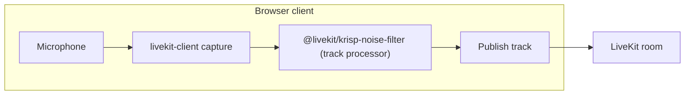

# LiveKit Noise Filter

## Audio chain

This package runs in the browser as a **track processor** on the local microphone capture. Cleaned audio is then published to the room.



## Usage

```ts

import { KrispNoiseFilter } from '@livekit/krisp-noise-filter';

...

await localAudioTrack.setProcessor(KrispNoiseFilter());

```
